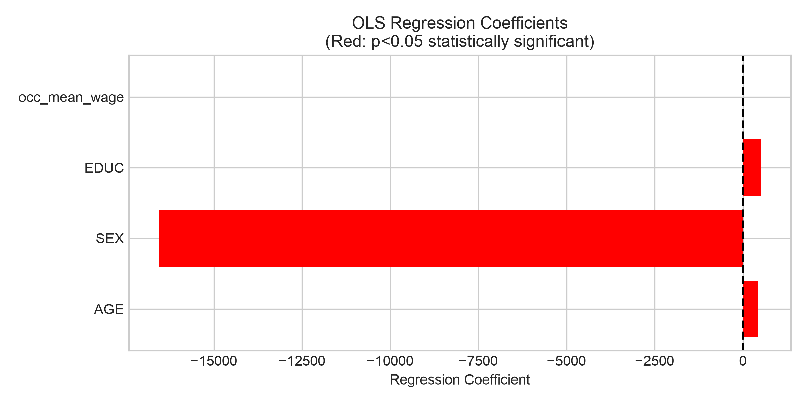

# My Data Science Portfolio
## About Me
Name: HE YING MC631173
Short introduction: I am a student taking CISC7204 Data Science and Data Visualization. This portfolio presents my exploratory regression analysis of wage determinants.

## Technical Skills
Python 3, Pandas, NumPy, Statsmodels, Matplotlib, data cleaning, weighted aggregation, dataset merging, OLS regression, regression diagnostic visualization.

## Project Showcase
### Project Title: Wage Determinants by Age, Sex, Education, and Occupation
Research Question: How are individual wage‑salary income levels associated with age, sex, education, and the average wage of a worker's occupation?

Brief explanation: This coefficient bar chart shows the exploratory OLS regression estimated associations between wage income and several demographic & occupational variables. Some predictors show statistically significant relationships at the 5% significance level. Note that these are associations rather than causal effects.

Project repository link: https://github.com/heying4002/data-science-project
Status: Completed
